# Wadi Al Ghubaitah — Online Shopping & E-Commerce Management System

A bilingual (English / Arabic) online store and management system for **Wadi Al Ghubaitah Trade & Cont.**, an Omani trading and contracting company. Customers browse, buy and track orders; staff manage products, stock, orders and customers; administrators also manage coupons, users and the financial reports.

Built with Next.js 14 (App Router), TypeScript, Tailwind CSS + shadcn/ui, next-intl, Auth.js v5, Prisma + SQLite, Zustand, Recharts, Vitest and Playwright.

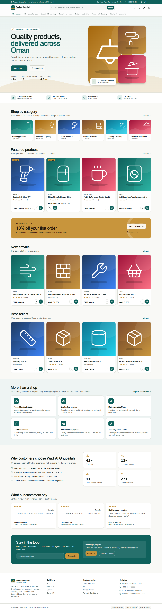

---

## Quick start

Requirements: **Node.js 20 LTS** (or newer) and Git.

```bash
git clone <repo-url> wadi-ecommerce
cd wadi-ecommerce
npm install                 # also generates the Prisma client
cp .env.example .env        # Windows: copy .env.example .env
npx auth secret             # writes AUTH_SECRET into .env.local (or paste any long random string into .env)
npx prisma migrate deploy   # creates prisma/dev.db
npm run seed                # loads the demo data and prints the demo accounts
npm run dev                 # http://localhost:3000  (redirects to /en)
```

Open **http://localhost:3000/en** for English and **http://localhost:3000/ar** for Arabic (right-to-left).

### Demo accounts

| Role | Email | Password | Can access |
|---|---|---|---|
| Administrator | `admin@wadialghubaitah.test` | `Admin@12345` | Everything, including coupons, users & roles, sales and payment reports |
| Staff | `staff@wadialghubaitah.test` | `Staff@12345` | Admin panel: orders, products, categories, inventory, customers, reviews, messages, operational reports |
| Customer | `customer@wadialghubaitah.test` | `Customer@12345` | Shop, cart, checkout, account, order tracking, reviews |

**Test payments (demo mode — no real money):** `4242 4242 4242 4242` succeeds, `4000 0000 0000 0002` is declined; any future expiry and any 3-digit CVC. Cash on delivery is also available. **Coupons:** `WELCOME10` (10 % off, min OMR 10.000) and `OMAN5` (OMR 5.000 off, min OMR 30.000).

### Scripts

| Command | What it does |
|---|---|
| `npm run dev` | Development server on port 3000 |
| `npm run build` / `npm start` | Production build / production server |
| `npm run seed` | Reset the database to the demo data (accounts, 42 products, 46 orders, payments, reviews…) |
| `npm run backup` | Consistent SQLite snapshot into `backups/` (keeps the newest 14) |
| `npm test` | Vitest unit tests (pricing/VAT/coupons, RBAC, validation, CSV) |
| `npm run test:e2e` | Playwright end-to-end purchase journey (needs `npm run build` first) |
| `npm run screenshots` | Re-captures `docs/screenshots/` |
| `npm run lint` / `npm run typecheck` | ESLint / TypeScript |
| `npx prisma studio` | Browse the database in the browser |

Playwright uses its own Chromium (`npx playwright install chromium`). To use an installed browser instead, set `PW_CHANNEL=msedge` (or `chrome`), e.g. `PW_CHANNEL=msedge npm run test:e2e`.

### Docker

```bash
docker build -t wadi-ecommerce .
docker run -p 3000:3000 -v wadi-data:/data -e AUTH_SECRET="$(openssl rand -base64 32)" wadi-ecommerce
```

The database is stored on the `/data` volume; the first start applies migrations and loads the demo data. Behind HTTPS, also pass `-e ENABLE_HTTPS_HEADERS=true` (adds HSTS).

---

## Features

**Storefront (EN + AR, RTL)**
- Home page with 11 sections: hero, trust strip, categories, featured products, WELCOME10 promo, new arrivals, best sellers, services, why-us statistics, customer reviews, newsletter/contact CTA
- Shop, category and search pages with filters (category, price range, in stock, rating), four sort orders and pagination — all working without JavaScript
- Product pages: gallery, price in OMR with three decimals, stock status, specifications, rating breakdown, verified reviews, related products, structured data
- Guest cart (Zustand) that merges into the account cart on sign-in; mini-cart drawer; quantities capped at live stock
- Checkout with all 11 governorates and their wilayats, saved addresses, Standard/Express delivery, coupons; totals (subtotal, discount, delivery, 5 % VAT) always computed on the server in **baisa**
- Simulated card gateway clearly labelled **“Test Payment — Demo Mode”**; only the last four card digits are stored; switch to cash on delivery after a decline
- Order placement in a single database transaction (re-pricing, stock check and guarded decrement, stock movements, coupon usage, notifications); order numbers `WG-XXXXX`
- Customer account: dashboard, orders with a visual tracking timeline, cancellation while Placed/Confirmed (restock + refund/void), wishlist, saved addresses, profile, change password, notifications with unread badge
- Reviews only after delivery, one per product, moderated by staff
- About, Services, Contact (saved to the database), FAQ, Privacy Policy, Terms & Conditions, localised 404
- Dark mode, keyboard navigation, skip links, WCAG AA contrast

**Admin panel (EN + AR, RTL)**
- Dashboard: KPI cards, 30-day sales trend, orders-by-status donut, top-5 products, recent orders
- Orders: filters, detail, forward-only status updates that notify the customer, cancellation, printable tax invoice
- Products CRUD with bilingual fields, specifications and generated artwork; categories CRUD
- Inventory: stock adjustments with reasons, full movement history, low/out-of-stock highlighting
- Customers, review moderation, contact messages
- Admin only: coupons, users & roles
- Five reports with date ranges, summary cards, charts, tables, CSV export and print view

**Security:** bcrypt passwords, zod validation everywhere, 5 failed logins / 15 minutes lock, role checks in middleware **and** in every page, server action and route handler (re-checked against the database), hashed single-use password-reset tokens, CSP and other security headers, CSV formula-injection protection, no secrets in client code.

---

## Report requirement → where it is in the website

The project report (“Online Shopping and E-Commerce Management System”, Chapter 3) lists these requirements. Each is implemented here:

| Report requirement | Where it is in the website | Who can use it |
|---|---|---|
| **Login** (FR) | `/en/login` — email + password, rate-limited, role-aware redirect | Everyone |
| **Change Password** (FR) | `/en/account/profile` → *Change password*; reset via `/en/forgot-password` | Signed-in users |
| **Create User Account** (FR) | `/en/register` — Omani phone validation, strong password | Visitors |
| **View Products** (FR) | `/en/shop`, `/en/category/…`, `/en/search?q=…`, `/en/product/…` | Everyone |
| **Add to Cart** (FR) | Cart icon on every product, header mini-cart, `/en/cart` | Everyone |
| **Online Payment** (FR) | `/en/checkout` → `/en/checkout/payment/WG-…` (demo gateway) or cash on delivery | Customers |
| **Order Tracking** (FR) | `/en/account/orders` → order timeline; admin `/en/admin/orders` | Customers / staff |
| **Notifications** (FR) | Header bell + `/en/account/notifications` (order, payment and account events) | Customers |
| **Customer Reviews** (FR) | Product page *Customer reviews*; moderation at `/en/admin/reviews` | Customers after delivery / staff |
| **Sales reports** (3.5.1) | `/en/admin/reports/sales` — revenue, discounts, VAT, daily chart, by category, CSV, print | Admin |
| **Product inventory reports** (3.5.1) | `/en/admin/reports/inventory` + `/en/admin/inventory` (adjustments, history) | Staff / admin |
| **Customer order reports** (3.5.1) | `/en/admin/reports/customer-orders` — top customers, governorates, CSV | Staff / admin |
| **Payment transaction reports** (3.5.1) | `/en/admin/reports/payments` — every card/COD transaction, success rate, refunds | Admin |
| **Delivery status reports** (3.5.1) | `/en/admin/reports/delivery` — status by governorate, delivery time, on-time rate | Staff / admin |
| Product management | `/en/admin/products`, `/en/admin/categories` | Staff / admin |
| Inventory management | `/en/admin/inventory` | Staff / admin |
| Customer communication | `/en/contact` → `/en/admin/messages`; status-change notifications | Everyone / staff |
| Interface & usability (3.5.2–3.5.3) | Responsive at 360/768/1280 px, Arabic RTL, dark mode, search in header | Everyone |
| Security (NFR) | Roles CUSTOMER/STAFF/ADMIN, `/en/admin/users`, security headers, hashed passwords | Admin |
| Accuracy (NFR) | Integer-baisa money, server-side totals, transactional orders, unit tests | — |
| Reliability / availability (NFR) | Error boundaries, `npm run backup`, Docker health check | — |
| Performance (NFR) | Lighthouse ≥ 90 on the English home page (see DECISIONS.md) | — |

---

## Screenshots

| | |
|---|---|
|  Home (English) | 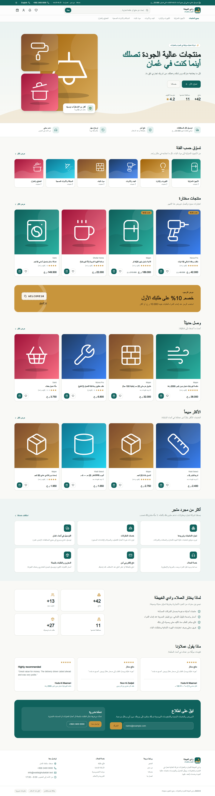 Home (Arabic, RTL) |
| 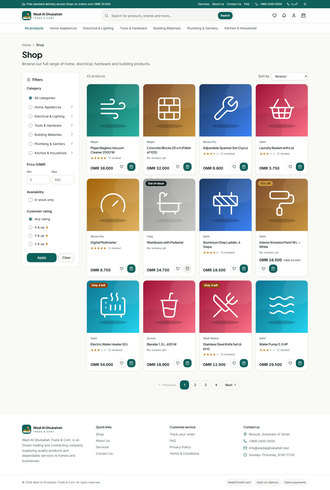 Shop | 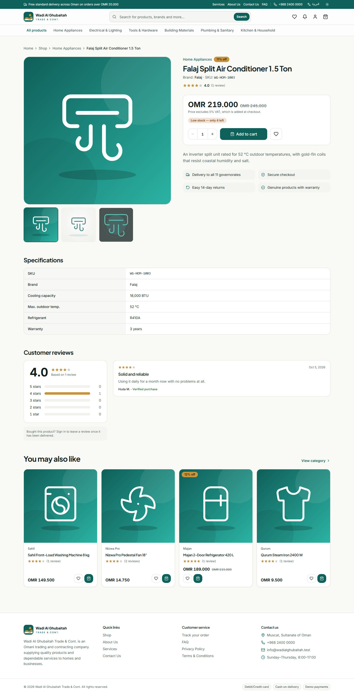 Product |
| 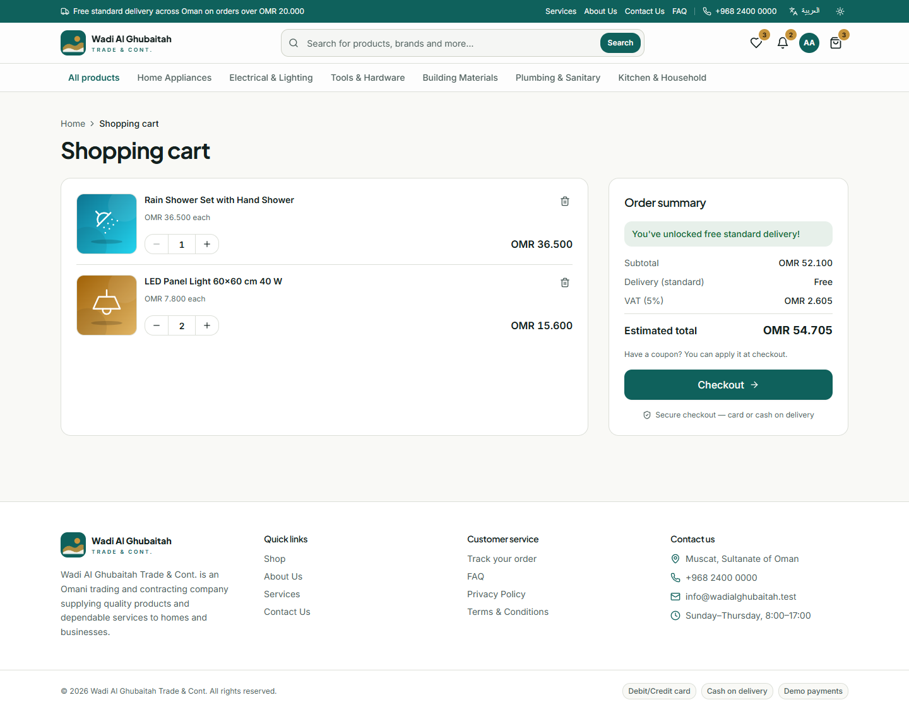 Cart | 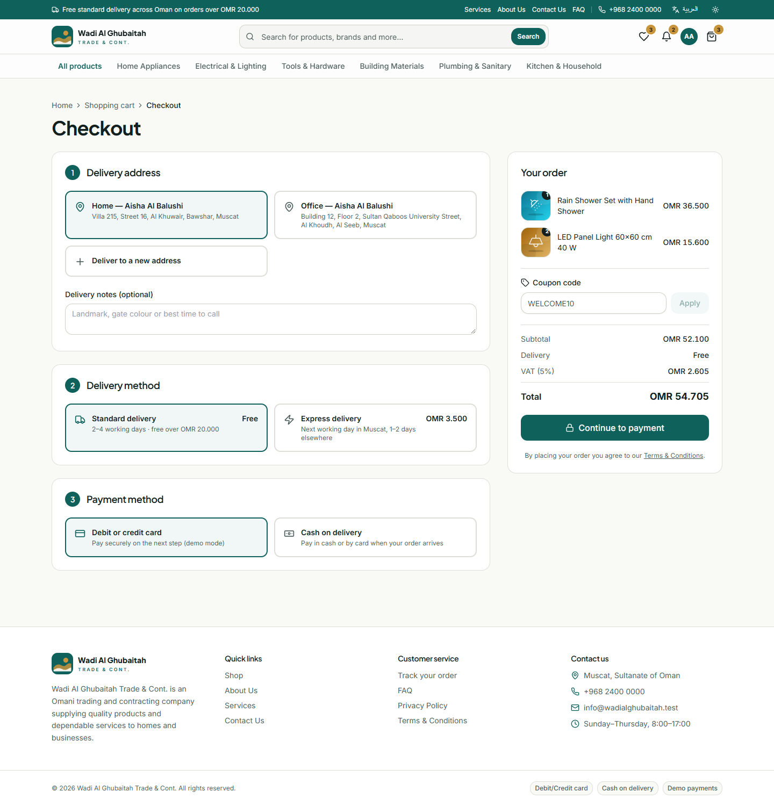 Checkout |
| 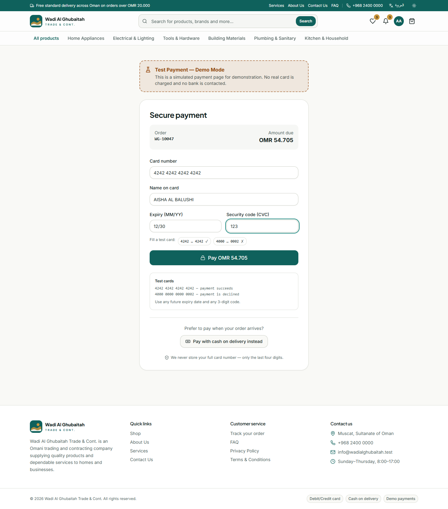 Test payment | 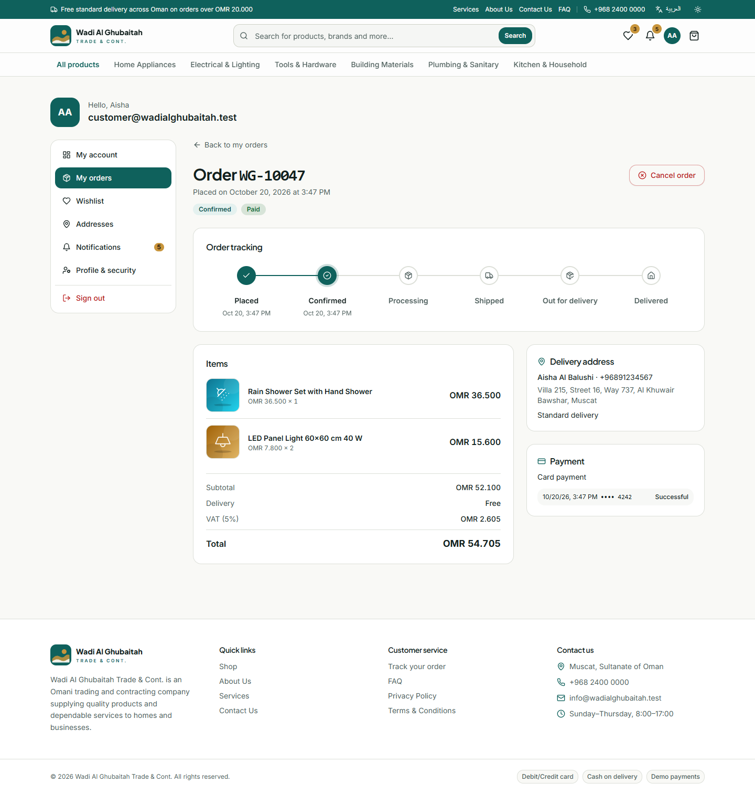 Order tracking |
| 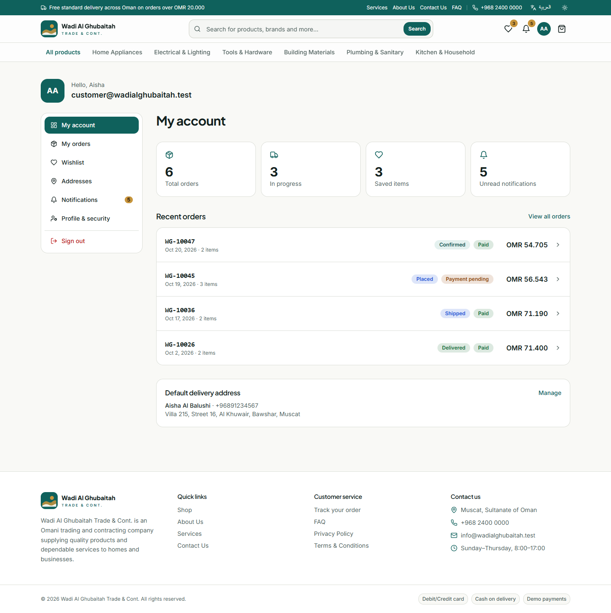 Customer dashboard | 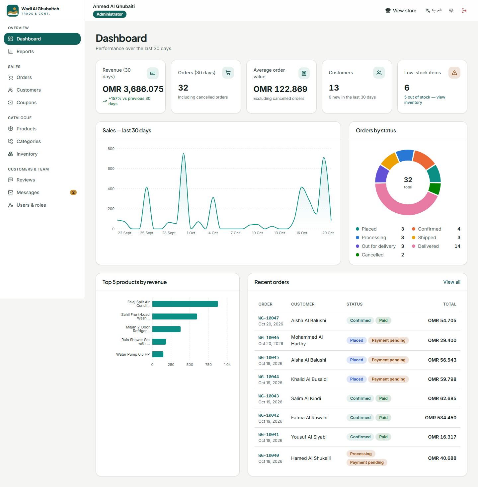 Admin dashboard |
| 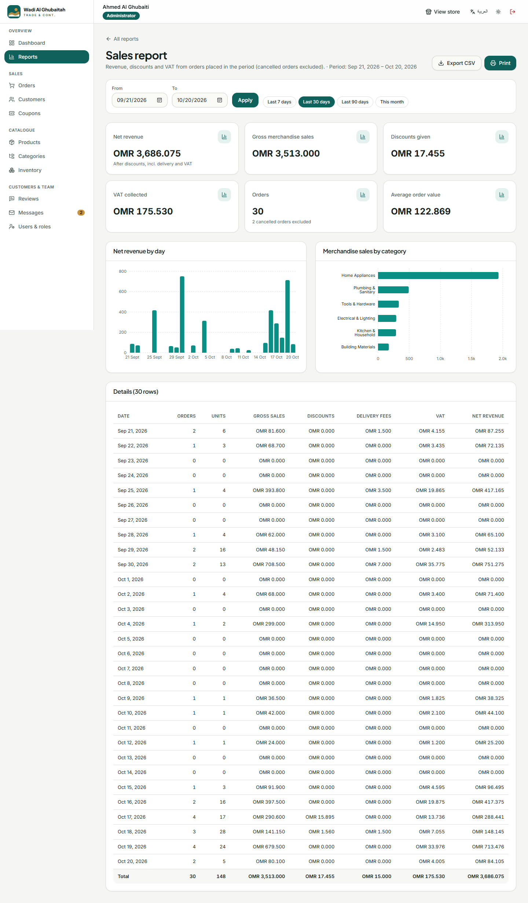 Sales report | 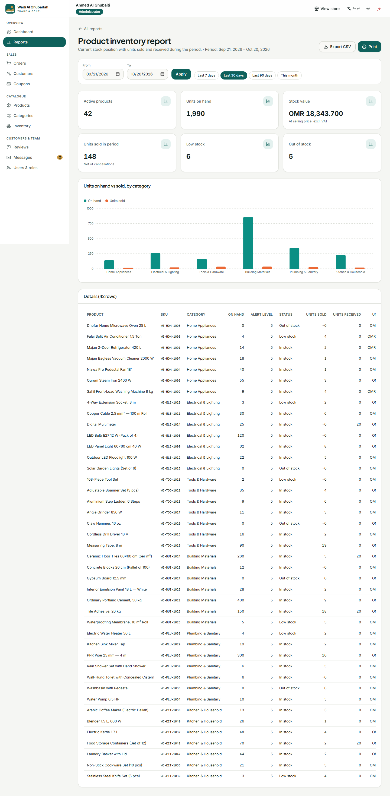 Inventory report |
| 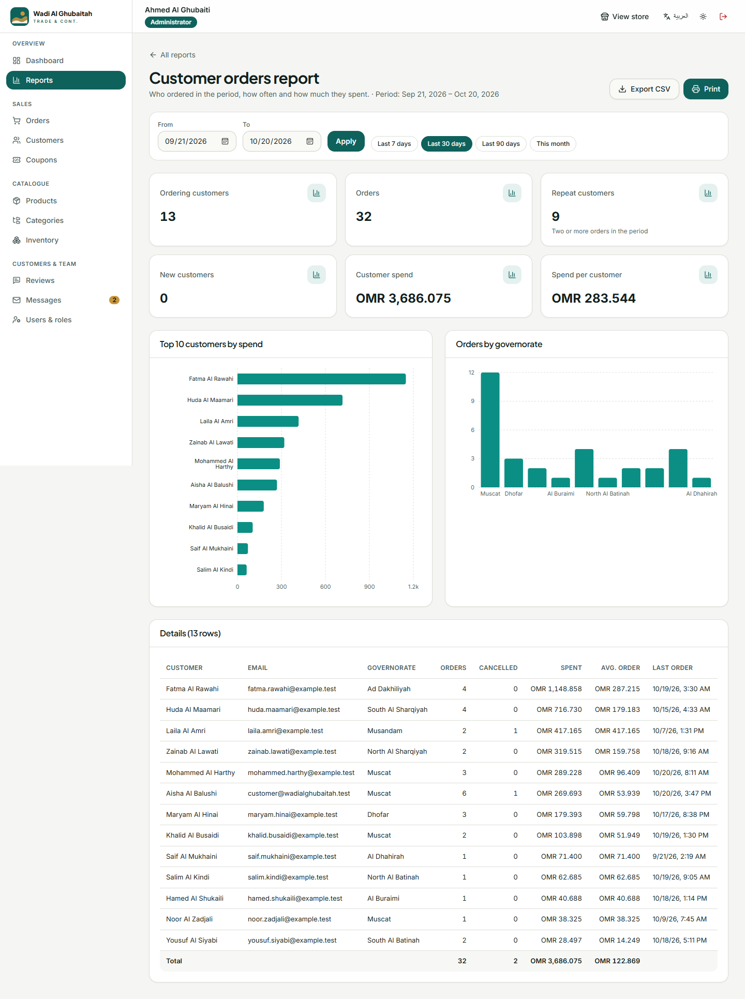 Customer orders report | 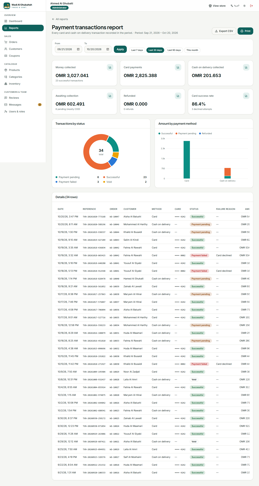 Payment transactions report |
| 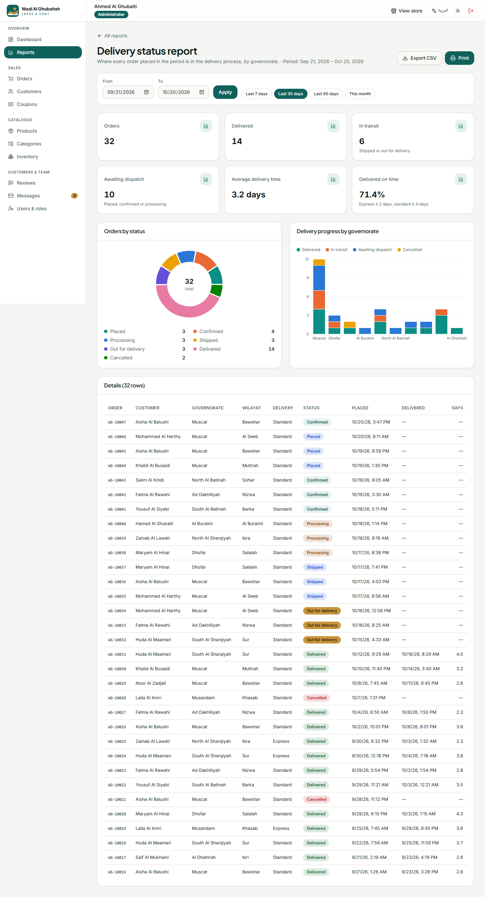 Delivery status report | |

---

## Project structure

```
messages/            en.json, ar.json — every UI string (≈1,100 keys)
prisma/              schema.prisma, migrations, seed.ts, seed-data.ts
src/app/[locale]/    (shop) storefront + account, admin/, error & 404 pages
src/app/api/         auth, CSV report export, generated product artwork
src/components/      ui (shadcn), layout, catalog, product, cart, checkout, account, admin, content
src/lib/             money, pricing (VAT/coupons), validation, rbac, dates, csv, constants
src/server/          server actions and queries (catalog, checkout, account, admin, reports)
tests/unit/          Vitest unit tests
e2e/                 Playwright purchase journey + screenshot capture
```

See **DECISIONS.md** for the design decisions and trade-offs.
